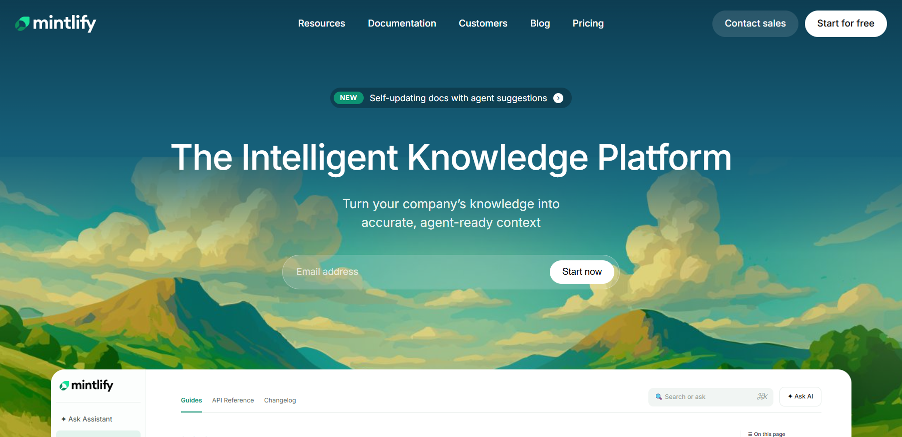
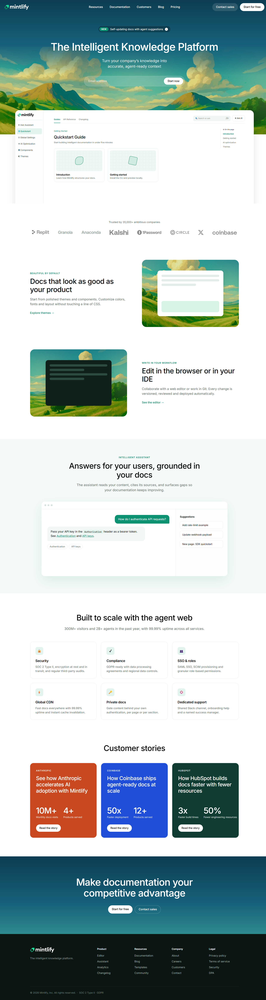

# Mintlify Docs Website Clone

Desktop-first recreation of the Mintlify landing page using only HTML and CSS (no JavaScript, no Tailwind, no animations).

**Files:** `index.html`, `styles.css`

## Sections recreated
1. Top navigation bar (logo, links, Contact sales / Start for free)
2. Hero (headline, description, email input + CTA, cloud illustration built in CSS)
3. Documentation preview (static sidebar, tabs, search, content cards, "On this page")
4. Trusted-by logo row
5. Feature highlights (two-column, alternating)
6. Intelligent assistant UI mockup
7. Enterprise features grid
8. Customer stories cards
9. Final call-to-action
10. Footer (multi-column links, legal info)

## Fonts and colors
- Font: Inter (Google Fonts), system sans-serif fallback
- Official brand colors (Brandfetch): Mountain Meadow `#18E299`, White `#FFFFFF`, Woodsmoke `#08090A`
- Logos and symbol: official SVGs from Brandfetch (`assets/`)
- Accent green `#0d9373` (from the logo's dark leaf), ink `#08090a`, muted `#5b6b66`, border `#e6ece9`, soft background `#f5faf8`
- Hero gradient: `#0d3d52` → `#5fb3a6`; cloud tones `#f3e9a8` / `#d6c474`

## Run
Open `index.html` in a browser (designed for ~1280px width).

## Screenshots
### Hero

### Full page

